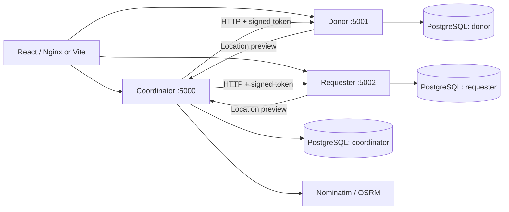

# HumanLog — Food Donation Coordination Platform

HumanLog connects food donors, requesters and coordinators in Hồ Chí Minh City. The React interface in `HumanLog Food Donation Platform` now uses the Flask APIs and PostgreSQL rather than demonstration records.

The project originated as a Top 10 finalist among 200+ teams at the HumanLog Hackathon.

## Three backend services

| Service | Port | PostgreSQL schema / login | Responsibilities |
| --- | --- | --- | --- |
| coordinator | 5000 | `coordinator` / `humanlog_coordinator` | Accounts, sign-in, coordinator operations, audit log, warehouse catalogue, OSM geocoding cache |
| donor | 5001 | `donor` / `humanlog_donor` | Create donations and return only the signed-in donor's records; coordinator-only management endpoints |
| requester | 5002 | `requester` / `humanlog_requester` | Create food requests and return only the signed-in requester's records; coordinator-only management endpoints |

These are three independent Flask/Waitress processes. The shared `backend/common` package contains validation, authentication and database utilities. Coordinator reads and changes donations/requests through authenticated HTTP calls to their owning services. It does not query their schemas. PostgreSQL and the Nginx frontend container are infrastructure.



## Access rules

| Account | Available pages | API permissions |
| --- | --- | --- |
| Donor | Donate Food, My Donations, own confirmation/tracking | Submit and read own donations |
| Requester | Request Food, My Requests, own confirmation/tracking | Submit and read own requests |
| Coordinator | Overview, Donations, Food Requests, Warehouses & Routes | View all records, edit food details/address/status, delete records |

Donor/requester accounts can self-register. A coordinator account must be created using the operator CLI below. There is no demo role selector. Changing the URL/hash cannot grant access. All three services verify RS256 tokens and roles. Record owners come from the token, never a submitted name or user ID. Another user's record returns 404. Donation and request IDs are separate UUIDs and are never renumbered.

The coordinator holds the private signing key; the other services receive only the public key. Browser sessions use an HttpOnly, SameSite=Lax cookie with a one-hour expiry. Browser writes require an allowed Origin. Sign-out clears the cookie; a copied token remains valid until its expiry. HTTPS deployments must set `COOKIE_SECURE=true` and configure their exact `FRONTEND_ORIGINS`.

## Run with Docker (PowerShell)

Prerequisites: Docker Desktop, Python 3.10+ for key generation, Node 22+ for local React development.

From the repository root:

```powershell
Copy-Item .env.example .env
python -m venv .venv
.\.venv\Scripts\python -m pip install -r backend\requirements.txt
.\.venv\Scripts\python backend\manage.py
docker compose up -d --build
```

Edit `.env` with your own passwords before starting. Use URL-safe database passwords because they are embedded in connection URLs. Key generation refuses to overwrite existing keys. `.env` and `backend/keys/` are ignored by Git. On an already configured checkout, use `docker compose up -d --build` directly.

Open **http://localhost:8080** or **http://127.0.0.1:8080**. Donors/requesters can create accounts on the welcome page. Both local addresses are included in `FRONTEND_ORIGINS`, along with the two Vite development addresses on port 8443.

If using another frontend address, add its exact scheme, host and port to `FRONTEND_ORIGINS` in `.env`, then run `docker compose up -d coordinator donor requester` to recreate those services with the updated configuration. Origin checks remain enabled for browser writes.

Create a coordinator interactively (the password is hidden):

```powershell
docker compose exec coordinator flask --app services.coordinator create-coordinator
```

Use that email/password on the normal Sign in page. There are no seeded production accounts or default coordinator credentials.

Use a valid email address and a password containing 10–128 characters. Interactive input is checked as you enter it; invalid fields are requested again and passwords remain hidden. When options such as `--email` or `--password` are supplied explicitly, invalid values produce a short field-specific error. A duplicate email does not overwrite an existing account.

```powershell
docker compose ps
docker compose logs coordinator donor requester
docker compose stop
```

Database data persists in the `humanlog_data` named volume. The schema initialization script runs only for a fresh PostgreSQL volume. Changing `.env` passwords for an existing volume requires updating the PostgreSQL roles as well. Existing database volumes must have the three roles/schemas provisioned before starting these services.

## Develop the React interface

Keep the Docker backend running, then:

```powershell
cd "HumanLog Food Donation Platform"
npm ci
npm run dev
```

Open **http://localhost:8443**. Vite proxies `/api` to the three local backend ports, so the browser uses one origin. `npm run preview` only previews static assets; use Vite dev or the Docker Nginx container for working API proxying.

```powershell
npm run typecheck
npm run build
```

## API routes

| Route | Access |
| --- | --- |
| `POST /api/auth/register` | Create a Donor or Requester account |
| `POST /api/auth/login`, `POST /api/auth/logout`, `GET /api/auth/me` | Session lifecycle |
| `POST /api/location/preview` | Authenticated form helper: coordinates, ranked warehouses and optional road route |
| `GET/POST /api/donor/donations`, `GET /api/donor/donations/{id}` | Donor only; reads restricted to owner |
| `GET/POST /api/requester/requests`, `GET /api/requester/requests/{id}` | Requester only; reads restricted to owner |
| `GET /api/coordinator/donations`, `GET /api/coordinator/requests` | Coordinator only |
| `PATCH/DELETE /api/coordinator/donations/{id}`, `PATCH/DELETE /api/coordinator/requests/{id}` | Coordinator only |
| `GET /api/coordinator/warehouses` | Coordinator only |
| `GET /api/coordinator/accounts?role=Donor` or `role=Requester` | Coordinator only; account choices for assigning record ownership |
| `/health` on each backend port | Database connectivity check |

The owning services expose `/internal/donations` and `/internal/requests` for the coordinator. These endpoints still verify the coordinator token, and Nginx does not expose `/internal/`. Legacy unprotected endpoints such as `/donations`, `/requests`, `/update_status`, and the Jinja admin pages are retired.

Requests and donations use `Pending`, `Processed`, `Picked Up`. Coordinator updates persist and appear in personal histories after refreshing; the UI also refreshes records every 15 seconds while visible. Fake driver assignments, receipts, contact actions and cancellation controls were removed.

## Maps and nearest warehouses

Leaflet displays OpenStreetMap tiles with attribution. Nominatim resolves an address when a user proceeds to review the form; it does not run autocomplete searches. Users can also click the map or enter latitude/longitude. The backend validates all coordinates and computes the closest of the original three Foodbank warehouses with the existing Haversine formula (Earth radius 6,371 km). The original warehouse coordinates are in `backend/services/geography.py`.

The public Nominatim service has an application-wide limit of **one request per second**. HumanLog serializes calls across coordinator workers through a PostgreSQL advisory lock, caches results for seven days and sends an identifying User-Agent. Set `OSM_USER_AGENT` with your application's contact information. Keep usage moderate, use public location information, and follow the [Nominatim usage policy](https://operations.osmfoundation.org/policies/nominatim/). `NOMINATIM_URL` can point to your own instance or another compatible provider without changing code.

OSRM provides road geometry, distance and estimated duration over HTTPS. If it is unavailable, the geographic warehouse suggestion and submission remain usable, and the UI shows that a road route is unavailable. Geographic and road distances are displayed separately. `OSRM_URL` is configurable. These maps show stored routes and do not represent live vehicle tracking.

## Tests

Backend tests need the Docker PostgreSQL container running. They create and remove a randomly named **separate test database** using the local PostgreSQL administrator credentials. They exercise real PostgreSQL schema permissions, ownership, authentication, validation, cross-service authorization, Haversine matching, geocoding cache and routing failure handling. External map providers are stubbed for repeatable backend tests.

```powershell
cd backend
..\.venv\Scripts\python -m pytest -q
```

You can override the administrator connection with `TEST_POSTGRES_URL`. The test database uses the three application login roles created by `infra/init-db.sh`.

Browser tests exercise the actual Docker frontend and three running backend services:

```powershell
cd "HumanLog Food Donation Platform"
npx playwright install chromium
npm run test:e2e
```

To include the coordinator editing/deletion flow, create a dedicated test coordinator through the operator CLI and set `E2E_COORD_EMAIL` and `E2E_COORD_PASSWORD` before running the suite. `E2E_BASE_URL` defaults to `http://localhost:8080`. Tests create uniquely named donor/requester accounts. With coordinator credentials, their test records are deleted after verification; otherwise the created records remain in the local development database. Screenshots and failure traces are under `test-results/` and ignored by Git.

With coordinator credentials, the second browser test also creates synthetic imported records using the repository's `.venv` Python, assigns them through the coordinator editor, checks personal histories, and confirms historical quantity units. These synthetic records are removed in a finally block; the actual SQLite imports are not modified.

## Existing SQLite data

The active system uses PostgreSQL. The original SQLite files and old template sources remain available for reference and recovery; no application routes serve them. The migration tool imports old records with a NULL owner because the source never recorded authenticated account IDs. They appear only in the coordinator lists until a coordinator assigns the correct registered Donor/Requester account. They never appear in a personal history merely because a submitted name matches an account name.

From the repository root, preview the import, then apply it:

```powershell
.\.venv\Scripts\python backend\migrate_legacy.py
.\.venv\Scripts\python backend\migrate_legacy.py --apply
```

The default sources are `backend/donations.db` and `backend/requestlist.db`. Applying creates consistent SQLite backups under `migration/backups/` before writing anything. `migration/legacy-plan.json` contains the record IDs and review notes. Both locations are ignored by Git. The importer uses the restricted donor and requester database logins from `.env`; it does not require a PostgreSQL administrator. For other database hosts, configure `DONOR_DATABASE_URL` and `REQUESTER_DATABASE_URL`, or `POSTGRES_HOST`, `POSTGRES_PORT` and `POSTGRES_DB`.

Each service has its own import ledger. Imports preserve original IDs in metadata and use deterministic new UUIDs. Running the tool again skips already imported records, preserves coordinator edits/ownership, and does not resurrect deleted records. Changed source rows are rejected for review. Each service's batch is transactional; if the second service fails after the first completed, fix the issue and rerun safely.

The old donation form used **grams**; the importer converts these to kg. Original quantity units were not recorded precisely, so imported quantities remain labelled **unit not recorded** until a coordinator verifies the units and selects the confirmation checkbox in the editor. Dates such as `12/2/2024` remain as original text until a coordinator confirms the exact date. Coordinates, status, stored route geometry, distance and duration are preserved without external map requests. Original rows are retained in the imported metadata.

Naive source timestamps are interpreted as `Asia/Ho_Chi_Minh`, matching the legacy service area, and their original text is preserved. If the old server used another timezone, select it explicitly with `--legacy-timezone` before the initial import.

To associate a migrated record with its owner:

1. Register the actual Donor/Requester account through the normal welcome page.
2. Sign in as a coordinator, open Donations or Food Requests, and select the record.
3. Select **Record owner** using the account's email. The selector lists only accounts of the correct role.
4. Check historical quantity units and expiry details, then save. The owner's personal history will display the record on its next refresh.

Only coordinators can view the account directory and assign ownership. The owning service validates the selected account and role through the coordinator's authenticated internal API; it still has no database access to the coordinator schema.

## Structure

```text
backend/
  services/coordinator.py    # Identity, coordination and map helper APIs
  services/donor.py          # Donation service factory
  services/requester.py      # Request service factory
  services/geography.py      # Original warehouses, Haversine, Nominatim, OSRM
  common/                    # Shared utilities, owner-filtered record endpoints
  tests/                     # PostgreSQL integration tests
  run.py                     # One process per chosen service
  manage.py                  # Signing-key generation
  migrate_legacy.py          # Read-only extraction, backups and repeatable import
HumanLog Food Donation Platform/
  src/App.tsx                # Role-scoped React flows
  src/api.ts                 # Typed API client and data models
  src/LiveMap.tsx             # OpenStreetMap display and pin selection
  tests/roles.spec.ts         # Browser integration test
infra/init-db.sh              # PostgreSQL logins and isolated schemas
compose.yaml                  # Three application services + frontend and database
```
